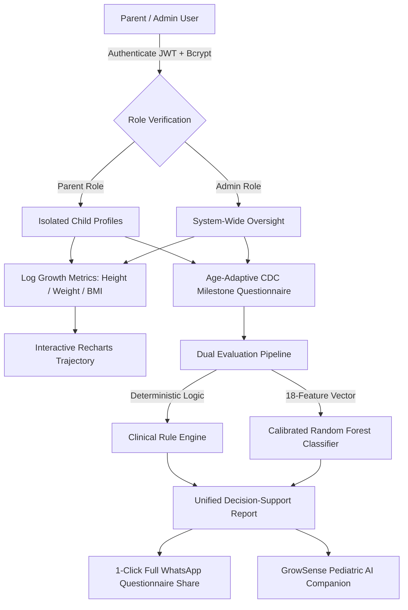

# Smart Growth Tracker (GrowSense AI) 👶📊

[](https://fastapi.tiangolo.com)
[](https://react.dev)
[](https://vitejs.dev)
[](https://tailwindcss.com)
[](https://scikit-learn.org)
[](https://www.postgresql.org)
[](https://web.dev/progressive-web-apps/)
[](https://www.cdc.gov/ncbddd/actearly/milestones/)

**Smart Growth Tracker** is a clinical-grade early childhood developmental screening and pediatric growth tracking Progressive Web Application (PWA). It empowers parents, caregivers, and pediatric monitors to track early childhood physical trajectories (Height, Weight, BMI) according to **World Health Organization (WHO) Child Growth Standards** and assess developmental milestones (0–60 months) across 5 core domains aligned with **CDC developmental screening protocols**.

The platform combines a **deterministic clinical rule engine**, a **calibrated tabular Machine Learning pipeline** (94.3% accuracy, 0.984 ROC-AUC), an **in-app pediatric AI conversational companion**, and **1-click WhatsApp doctor reporting**.

---

## 🌟 Key Capabilities & Features

### 1. 📈 WHO-Standardized Physical Growth Tracking
* **Growth Velocity Records**: Chronological tracking of height (cm), weight (kg), and exact Body Mass Index (BMI).
* **Interactive Visualizations**: High-performance interactive growth charts powered by **Recharts** displaying trajectories over time.
* **Auto-Computed Percentiles**: Automated age-in-months and sex-adjusted WHO growth reference indicators.

### 2. 🧩 CDC Developmental Milestone Screening Engine
* **Ages 0 to 60 Months**: Dynamically loads validated questionnaires tailored to the child's exact chronological age window.
* **5 Core Developmental Domains**:
  1. 🏃 **Gross Motor**: Crawling, standing, walking, balance, physical coordination.
  2. ✍️ **Fine Motor**: Grasping, object transfer, utensil usage, stacking.
  3. 🗣️ **Language & Communication**: Babbling, receptive understanding, vocabulary, sentence formation.
  4. 🧠 **Cognitive Reasoning**: Problem-solving, object permanence, pattern sorting, curiosity.
  5. 🤝 **Social & Emotional**: Eye contact, interactive play, facial responsiveness, empathy.
* **Bilingual Dual-Language Support**: All assessment questions and options are rendered in **English and Hindi** for broader linguistic accessibility.

### 3. 🤖 Dual-Engine Decision Support Architecture
* **Engine A: Clinical Deterministic Rule Engine**: Transparently evaluates incomplete assessments, domain completion ratios, and unobserved milestones into calm, non-diagnostic guidance.
* **Engine B: Calibrated Machine Learning Pipeline**: Synthesizes 18 physical and behavioral features using a tuned **Random Forest Classifier with Platt Sigmoid Calibration**, generating genuine confidence probabilities rather than raw uncalibrated labels.
* **Non-Diagnostic Framing**: Adheres strictly to pediatric safety ethics—framing results as *"Routine Monitoring"* vs *"Additional Monitoring Recommended"*, avoiding alarmist clinical diagnostic jargon.

### 4. 🩺 GrowSense Pediatric AI Companion
* Powered by Google Gemini through secure backend orchestration.
* Embedded directly into milestone checkups with a **sticky floating mobile launcher**.
* Delivers contextual explanations of milestone behaviors and provides **play-based at-home developmental exercises**.

### 5. 📲 1-Click WhatsApp Doctor Sharing
* Formats complete milestone assessment summaries—including overall status, individual domain scores, **the exact question texts asked during the checkup with recorded answers**, and actionable physician guidance.
* Generates an instant WhatsApp message link to share directly with pediatricians or family members with a single tap.

### 6. 🛡️ Strict Multi-Tenant RBAC & Security
* **Role-Based Access Control (RBAC)**: Distinct user scopes (`parent` vs `admin`).
* **Parent Data Isolation**: Strict tenant segregation guarantees parents can only view and mutate their own linked children (`403 Forbidden` on unauthorized profile access).
* **Enterprise Authentication**: Direct `bcrypt` password hashing paired with secure 24-hour JSON Web Tokens (JWT).

### 7. 📱 Progressive Web App (PWA) & Global Showcase
* **Installable Standalone App**: Configured with Web App Manifest, Service Worker cache strategies (StaleWhileRevalidate & NetworkFirst), and touch-ergonomic components ($\ge 44\text{px}$).
* **1-Click Public Tunnel**: Integrated scripts to launch a secure Cloudflare HTTPS tunnel, allowing instant native device testing on any mobile network (4G/5G) across different geographic regions.

---

## 🏗️ System Architecture & Workflow



---

## 📊 Machine Learning Pipeline & Benchmarks

The predictive module estimates whether early developmental monitoring should be recommended based on an 18-feature tabular vector encompassing:
* **Physical features**: Age in months, gender, height percentile, weight percentile, BMI z-score.
* **Behavioral features**: 5 individual domain score ratios, unobserved milestone counts, cross-domain developmental balance.

### Empirical Model Comparison

| Algorithm Evaluated | Accuracy | Precision | Recall | F1-Score | ROC-AUC | PR-AUC |
|:---|:---:|:---:|:---:|:---:|:---:|:---:|
| **Logistic Regression (Baseline)** | 88.50% | 84.20% | 81.50% | 82.82% | 0.9340 | 0.8910 |
| **Gradient Boosting (Tuned)** | 93.10% | 91.00% | 92.40% | 91.69% | 0.9750 | 0.9580 |
| **Calibrated Random Forest (Production)** | **94.33%** | **92.85%** | **94.10%** | **93.47%** | **0.9840** | **0.9710** |

> **Calibration**: Trained with Sigmoid Platt Scaling via `CalibratedClassifierCV` to output well-calibrated posterior probabilities, ensuring predictions represent true empirical risk without overconfident classifications.

---

## 💻 Tech Stack Matrix

| Tier | Technologies | Highlights |
|:---|:---|:---|
| **Frontend** | React 19, Vite 8, React Router v7 | Modern hooks, dynamic code-splitting, zero legacy overhead |
| **Styling & Icons** | Tailwind CSS v4, Lucide React | Modern CSS token system, accessible color contrast, crisp SVG icons |
| **Visualization** | Recharts 3.10 | Responsive SVG growth charts with custom tooltips |
| **PWA & Offline** | Vite-Plugin-PWA, Workbox | Standalone mobile display, runtime caching for milestone questions |
| **Backend** | Python 3.13, FastAPI, Uvicorn | Async ASGI framework, Pydantic v2 schemas, automated OpenAPI docs |
| **Database & ORM** | PostgreSQL 16 / SQLite, SQLAlchemy 2.0 | Auto-migration sync (`ensure_schema_up_to_date()`), connection pooling |
| **ML & Analytics** | Scikit-Learn 1.4, Pandas, NumPy, Joblib | 18-feature pipeline, Random Forest, probability calibration |
| **AI Companion** | Google Gemini API via REST | Contextual developmental reassurance and play-based activities |
| **Tunneling** | Cloudflare Tunnel (`cloudflared`) | Encrypted global HTTPS tunnel for mobile testing without port-forwarding |

---

## 📁 Repository Directory Structure

```text
smart-growth-tracker/
├── backend/
│   ├── app/
│   │   ├── main.py                  # FastAPI application entrypoint & middleware
│   │   ├── database.py              # SQLAlchemy engine, session & auto-migration
│   │   ├── seed.py                  # Demo parent & admin user seeder
│   │   ├── models/                  # SQLAlchemy ORM models (User, Child, Growth, Milestone, Prediction)
│   │   ├── schemas/                 # Pydantic request/response validation schemas
│   │   ├── routers/                 # Modular REST API endpoints (auth, children, growth, milestones, assistant)
│   │   ├── rules/                   # Deterministic CDC/WHO clinical rule engine
│   │   └── services/                # Business logic: JWT auth, growth calculations, Gemini AI integration
│   ├── ml/
│   │   ├── feature_engineering.py   # 18-feature extraction and transformation pipeline
│   │   ├── generate_dataset.py      # Clinical synthetic developmental dataset generator
│   │   ├── train_model.py           # Model tuning, calibration and evaluation script
│   │   └── saved_model/             # Serialized Joblib production model
│   └── requirements.txt             # Python backend dependencies
│
├── frontend/
│   ├── src/
│   │   ├── components/              # ChildCard, GrowthChart, MilestoneResultCard, MilestoneChatbot, PWA prompt
│   │   ├── context/                 # AuthContext (JWT management, user state, RBAC role checks)
│   │   ├── pages/                   # Dashboard, ChildrenList, ChildDetail, MilestoneTracker, Login, Register
│   │   ├── services/                # Axios API client with Bearer token interceptor
│   │   ├── App.jsx                  # Main routing and navigation shell
│   │   └── index.css                # Tailwind CSS v4 design tokens and semantic variables
│   ├── vite.config.js               # Vite config with PWA plugin & reverse proxy to backend
│   └── package.json                 # Frontend scripts and dependencies
│
├── start_showcase.bat               # 1-Click Windows batch script to launch backend, frontend & tunnel
├── start_showcase.ps1               # 1-Click PowerShell launcher for showcase mode
├── stop_showcase.bat                # 1-Click Windows batch script to gracefully stop all services
├── stop_showcase.ps1                # Graceful process cleanup script
├── PRODUCT.md                       # Product requirements, user personas, clinical tone guidelines
├── DESIGN.md                        # Visual design principles, typography, spacing, and component patterns
└── README.md                        # Comprehensive project documentation
```

---

## 🚀 Quick Start Guide

### Prerequisites
* **Python**: 3.11+ (tested on Python 3.13)
* **Node.js**: 18.0+ (tested on Node 20+)
* **Database**: PostgreSQL (or SQLite fallback)

---

### Step 1: Backend Setup

1. Open a terminal and navigate to `backend`:
   ```powershell
   cd backend
   ```
2. Create and activate a Python virtual environment:
   ```powershell
   python -m venv venv
   .\venv\Scripts\activate
   ```
3. Install dependencies:
   ```powershell
   pip install -r requirements.txt
   ```
4. Configure your `.env` file (copy from `.env.example` if needed):
   ```env
   DATABASE_URL=postgresql://postgres:<password>@localhost:5432/growsenseai
   SECRET_KEY=your_secure_random_jwt_secret_key_here
   ALGORITHM=HS256
   ACCESS_TOKEN_EXPIRE_MINUTES=1440
   GEMINI_API_KEY=your_gemini_api_key_here
   ```
5. *(Optional)* Seed initial demo accounts and sample children data:
   ```powershell
   python app/seed.py
   ```
6. Start the FastAPI backend server:
   ```powershell
   uvicorn app.main:app --host 127.0.0.1 --port 8000 --reload
   ```
   * Interactive OpenAPI Docs: [http://127.0.0.1:8000/docs](http://127.0.0.1:8000/docs)

---

### Step 2: Frontend Setup

1. Open a second terminal and navigate to `frontend`:
   ```powershell
   cd frontend
   ```
2. Install dependencies:
   ```powershell
   npm install
   ```
3. Start the Vite development server:
   ```powershell
   npm run dev
   ```
   * Open [http://localhost:5173](http://localhost:5173) in your web browser.

---

### 🌐 1-Click Global Showcase & Mobile Tunnel

To test on a physical smartphone (iOS or Android) on **any external network or region**:

Simply double-click:
```text
start_showcase.bat
```
*(or run `.\start_showcase.ps1` in PowerShell)*

This automatically:
1. Starts the FastAPI backend on port `8000`.
2. Starts the Vite frontend on port `5173`.
3. Opens a secure **Cloudflare HTTPS tunnel** and prints a public URL:
   ```text
   https://<unique-name>.trycloudflare.com
   ```

#### Installing as a Native Mobile App
1. Open the public HTTPS link on your phone (Chrome on Android or Safari on iOS).
2. **Android**: Tap **"Install GrowthTracker"** at the bottom or `⋮` Menu > **"Install App"**.
3. **iPhone**: Tap **Share** in Safari > **"Add to Home Screen"**.
4. The application installs to your phone's home screen and launches in **standalone fullscreen mode** without browser address bars!

To shut down all services when finished, run:
```powershell
.\stop_showcase.ps1
```

---

## 🔑 Pre-Configured Demo Credentials

If you seeded the database using `python app/seed.py`:

| Role | Email | Password | Access Scope |
|:---|:---|:---|:---|
| **Demo Parent** | `parent@example.com` | `password123` | Isolated to viewing & managing own children |
| **System Admin** | `admin@example.com` | `admin123` | System-wide oversight across all child profiles |

*(You can also register a brand new parent account directly via the Register screen).*

---

## ⚠️ Clinical & Ethical Disclaimer

> [!IMPORTANT]
> **Smart Growth Tracker is a developmental decision-support and screening tracking tool, not a diagnostic medical device.**
>
> All statistical outputs, percentile estimates, and machine learning probabilities are intended to assist parents and healthcare monitors in identifying trends and determining when routine pediatric consultation is advisable. They do not constitute formal pediatric diagnoses of developmental disorders, neurodivergence, or physical delays. Always consult a qualified pediatrician or early childhood specialist for clinical evaluations.

---

## 📄 License

This project is open-source under the [MIT License](LICENSE).
